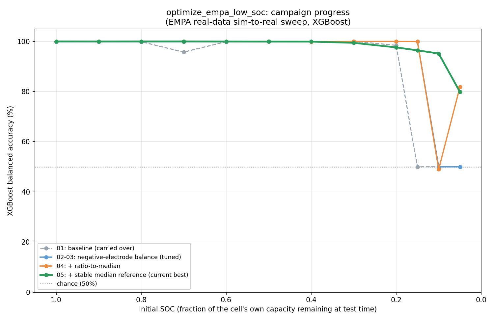

# optimize_empa_low_soc: campaign index

## Objective

Starting from the bug-fixed, full-scale-verified EMPA SOC-sweep pipeline
built while merging three colleagues' branches (`optimize_empa_2/` on
this same branch, `optimize-empa-2-merge`), push balanced accuracy as
high as possible at as low an Initial_SOC as possible. Deliberately
kept separate from `optimize_empa_2/` (the colleagues' shared pipeline
-- not ours to restructure) and from `experiments/32_fixed_voltage_cutoff_soc_sweep/`
(a different, already-concluded campaign on `main`).

**Objective refined after attempt 05**: chasing per-bucket accuracy at
the lowest possible Initial_SOC was the wrong framing -- the actual
production need (Stena Recycling: a battery's SOC at test time is
unknown) is **one model that classifies chemistry correctly regardless
of what SOC it happens to be tested at**, not a collection of
SOC-specialized models. Attempts 06-07 pursue that reframed goal
directly; see below.

## Data sources

Each attempt's own `data/optimize_empa_low_soc_NN_.../` namespace
(synthetic and real both), self-contained and not shared with
`optimize_empa_2/`'s `data/raw/` paths, so this campaign's data can be
regenerated or modified without touching the colleagues' pipeline.

## Progress at a glance

(Random Forest and attempt 02 omitted -- see `make_plot.py`'s docstring
for why: XGBoost dominates at every SOC point tested, and attempt 02's
XGBoost curve is pixel-identical to attempt 03's.)

**This chart predates attempts 06-07 and is not regenerated here** --
it documents the per-SOC-specialized era (01-05) specifically,
including the now-corrected premise that Random Forest underperforms
XGBoost (see the two sections below). For the current, superseding
result, see `experiment/06_pooled_model_full_soc_range/outputs/plots/soc_sweep_accuracy_empa.png`
(RF vs. XGBoost, pooled model) and `experiment/07_mlp_rbf_comparison/outputs/plots/soc_sweep_accuracy_empa.png`
(adds MLP and an RBF-kernel SVM) -- both show a flat accuracy curve
across the full SOC range, unlike anything in the chart above.

## Running log of attempts

| # | Folder | Idea | Best result | Status |
|---|---|---|---|---|
| 01 | `experiment/01_baseline_carryover/` | Carry over the bug-fixed, full-scale-verified `optimize_empa_2` pipeline unchanged, as this campaign's starting point | XGBoost: 95.7-99.9% from SOC 1.0 down to 0.2, collapses to chance at 0.15 and below. Random Forest: chance-level (majority-class prediction) at every SOC point | Baseline, verified (re-run from scratch in this new, self-contained location; reproduces the merge work's full-scale numbers exactly -- see its own RESULTS.md) |
| 02 | `experiment/02_negative_electrode_balance/` | LFP negative-electrode capacity rebalance (factor=0.7, carried over from `optimize_empa/experiment/01_...`), targeting the LFP OCP calibration gap root-caused in attempt 01 | XGBoost: working range extended a full SOC step lower, now 95.7-99.9% down to **0.15** (was 0.2). Random Forest: recovered at SOC 1.0/0.9 (99.87%, was chance), still chance-level 0.8 and below. Both models still chance below 0.1 | Verified at full scale; a real, partial improvement -- see its own RESULTS.md for the full before/after table and the sanity-check diagnostic that preceded the full run |
| 03 | `experiment/03_tuned_negative_electrode_factor/` | Swept `NEG_CAPACITY_FACTOR` (0.4-0.8) against this pipeline's own calibration gap instead of assuming attempt 02's borrowed 0.7 was optimal; found 0.45-0.47 fits real LFP noticeably better | Random Forest partially recovers at SOC=0.8 (LFP recall 0.000 -> 0.281). XGBoost essentially unchanged (already saturated 1.0-0.15 with the looser factor) -- no further SOC-range extension. Diminishing returns from this lever alone | Verified at full scale -- see its own RESULTS.md; recommends a different/additional lever next (ratio-to-median scale-invariant features) |
| 04 | `experiment/04_ratio_to_median_features/` | Ratio-to-median scale-invariant features (each bin's dV/dQ divided by that row's own median), layered on attempt 03's synthetic data -- a feature-representation fix rather than a physics fix | Mixed: Random Forest regresses to chance everywhere it was working in attempt 03 (1.0/0.9/0.8). XGBoost breaks through at the lowest SOC point in the whole campaign: Initial_SOC=0.05 goes from chance to **81.81%** balanced accuracy (LFP recall 0.000 -> 1.000) | Verified at full scale -- see its own RESULTS.md. Head-to-head check against attempt 03 (below) showed XGBoost dominates regardless of feature set -- no hybrid needed |
| 05 | `experiment/05_stable_median_reference/` | Root-caused and fixed why Initial_SOC=0.1 stayed at chance while the more extreme 0.05 worked: ratio-to-median's per-row median was computed over whatever bins that row had, which varies by SOC-truncation depth. Fixed the median denominator to a consistent reference bin set | **Initial_SOC=0.1: chance (48.98%) -> 95.17%** (LFP recall 0.000 -> 1.000) -- the campaign's biggest single jump. Real but modest cost elsewhere: 0.3/0.2/0.15 drop from ~100% to 96-99% (still solid); 0.05 dips to 79.84% | Verified at full scale -- see its own RESULTS.md; superseded by attempt 06's broader revision (per-SOC specialization itself dropped) |
| 06 | `experiment/06_pooled_model_full_soc_range/` | Abandoned per-SOC specialization entirely: ONE model trained once on a genuinely full-range synthetic set (continuous-discharge-truncated, Initial_SOC 0.05-1.0, 5,976 rows -- not the old 0.5-1.0-floor, rest-initialized generator), evaluated at every real SOC bucket | **Fixes Random Forest completely** (96.88-98.47% balanced accuracy at every bucket, matching XGBoost 97.19-99.08%) -- confirms the RF "collapse" in attempts 01-05 was per-SOC specialization shrinking training sets to ~100-500 rows, not a data or RF problem. Accuracy-vs-SOC is now flat (no cliff at low SOC at all): 98.53%/98.47% (XGB/RF) at SOC=0.05, vs. attempt 05's 79.84% there | Verified at full scale -- see its own RESULTS.md; this campaign's current best, and the new recommended design |
| 07 | `experiment/07_mlp_rbf_comparison/` | Same pipeline as attempt 06 (same data, same preprocessing), but trains an MLP and an RBF-kernel SVM alongside RF/XGBoost, all four plotted together -- does the pooled-model result generalize beyond tree ensembles? | MLP matches RF/XGBoost (97.11-99.12% balanced accuracy, same flat SOC curve, zero tuning). RBF SVM works but trails by a consistent 3-7 points (91.90-95.69%) -- not degenerate, just a weaker untuned baseline | Verified at full scale -- see its own RESULTS.md; confirms attempt 06's flat, high-accuracy result isn't an artifact of tree-based methods specifically |

## Current best, and a correction to attempt 04's "next steps"

Attempt 04 proposed a per-bucket hybrid (attempt 03's Random Forest for
Initial_SOC 1.0-0.8, attempt 04's XGBoost below) on the premise that
attempt 03's RF "won" at the top of the sweep. Checking that premise
properly -- comparing **all four** model/feature combinations
(attempt 03 RF/XGB, attempt 04 RF/XGB) head-to-head at every SOC point,
not just RF-under-ratio-to-median against RF-under-raw-features --
found that premise was wrong:

| SOC | A03 RF | A03 XGB | A04 RF | A04 XGB | Best |
|---|---|---|---|---|---|
| 1.0 | 99.87 | 99.87 | 50.00 | **99.95** | A04-XGB |
| 0.9 | 99.87 | 99.87 | 50.00 | **99.94** | A04-XGB |
| 0.8 | 63.93 | 99.87 | 50.00 | **99.98** | A04-XGB |
| 0.7-0.5 | ~50 | ~99.9 | ~50 | ~99.9-100 | A04-XGB (narrowly) |
| 0.4 | ~50 | 99.91 | ~50 | 99.89 | A03-XGB (narrowly) |
| 0.3-0.2 | ~50 | 99.99 | ~50 | **100.00** | A04-XGB |
| 0.15 | ~50 | **99.99** | ~50 | 99.92 | A03-XGB (narrowly) |
| 0.1 | 50.00 | 49.99 | 50.00 | 48.98 | all chance |
| 0.05 | 50.00 | 50.00 | 50.00 | **81.81** | A04-XGB |

**XGBoost wins or ties at every single SOC point, regardless of
feature set.** Random Forest never actually wins anywhere -- attempt
03's RF successes (1.0/0.9/0.8) are matched or exceeded by attempt
04's XGBoost. The differences between attempt 03's and attempt 04's
XGBoost are noise-level (<0.1pp) everywhere except Initial_SOC=0.05,
where attempt 04 is dramatically better.

**Conclusion: attempt 04's ratio-to-median + XGBoost pipeline, alone,
is already this campaign's best unified result across the sweep** --
no hybrid needed. Random Forest can be dropped from future attempts;
it's dominated by XGBoost in every configuration tested so far.

**The Initial_SOC=0.1 anomaly was root-caused and fixed in attempt 05.**
Ratio-to-median (attempt 04) normalizes each row by its own median
over *whatever bins that row happens to have* -- and which bins a real
cycle has depends on how deep its SOC truncation goes (confirmed
directly: real LFP has 100% coverage of the 3.2-3.1V bin at SOC=0.1,
but 0% coverage of that same bin at SOC=0.05). So the normalizing
denominator was itself SOC-truncation-dependent. Fixing the median
reference to a consistently-covered bin subset (2.6V-3.1V) took
Initial_SOC=0.1 from chance (48.98%) to **95.17%** -- at a real but
modest cost elsewhere (0.3/0.2/0.15 drop from ~100% to 96-99%, still
solid; 0.05 dips slightly to 79.84%). See `experiment/05_stable_median_reference/RESULTS.md`.

## Experiment 06 revises the "Random Forest can be dropped" conclusion

The head-to-head above concluded Random Forest is dominated by
XGBoost "in every configuration tested so far" -- true for every
per-SOC-specialized configuration, but it turned out to be an artifact
of *how* RF was being used, not a property of RF itself. Investigating
why RF sat at ~50% balanced accuracy (always predicting NMC) while
XGBoost scored well on identical data found the cause: per-SOC
specialization (introduced upstream, inherited by every attempt here)
narrowed each bucket's training set to ~100-500 rows, which
`RandomForestClassifier(max_depth=10)` overfits on while XGBoost's
built-in regularization tolerates. Separately, per-SOC specialization
was never actually the right design for the stated goal (one model,
unknown test-time SOC) -- it existed only as a workaround for the
synthetic generator's `Initial_SOC>=0.5` floor.

Attempt 06 removes per-SOC specialization and that floor at once (see
its own RESULTS.md): one pooled model, trained on continuous-discharge-
truncated synthetic data spanning the full 0.05-1.0 range. Result: RF
matches XGBoost everywhere (96.88-98.47% vs. 97.19-99.08%), and the
accuracy-vs-SOC curve is flat all the way down to 0.05 -- no cliff,
unlike every per-SOC-specialized attempt. **This is now the campaign's
recommended design**; attempts 01-05's per-SOC specialization and
ratio-to-median machinery are superseded, not because they were
wrong, but because they were solving a problem (SOC-truncation-
dependent training) that doesn't exist once the synthetic data
actually covers the full SOC range with physically-correct generation.

## Background

Full derivation and debugging history (the colleague-branch comparison,
a `Battery_ID`/`DataKind` mapping bug found and fixed, a root-caused
LFP OCP calibration mismatch, and an inconclusive investigation into
why colleagues' own reported numbers didn't show this collapse) lives
in this session's conversation history and in `experiment/01_baseline_carryover/RESULTS.md`.
Not repeated in full here -- this campaign builds on that conclusion
rather than re-deriving it.
