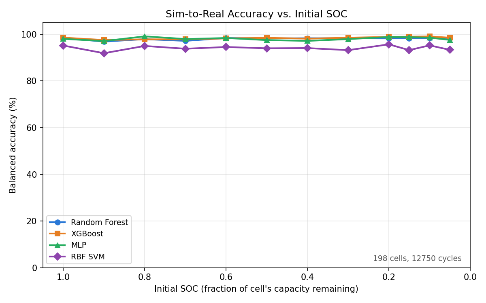

# optimize_empa, experiment 07: MLP + RBF SVM comparison

## The question this answers

Experiment 06 established a pooled model (one Random Forest + one
XGBoost, trained once on the full-SOC-range synthetic set, evaluated
at every real EMPA bucket) as this campaign's best design. This
experiment asks whether other model families hold up under the same
pipeline: a Multi-Layer Perceptron and a radial-basis-function model,
trained and evaluated identically, all four plotted together.

**A note on "RBF Network"**: scikit-learn has no built-in RBF-network
classifier. Three implementations were considered -- a classic
KMeans-centers + Gaussian-basis + linear-readout network, an
`RBFSampler` kernel-approximation pipeline, or a plain RBF-kernel SVM
-- and `sklearn.svm.SVC(kernel="rbf")` was chosen. Stated plainly: this
is an RBF-kernel SVM, a max-margin classifier, not a network
architecture (no hidden layer, no readout layer), despite using the
same radial basis function. Labeled "RBF SVM" throughout, not "RBF
Network", to keep that distinction visible.

## What changed from experiment 06

Nothing about the data or preprocessing -- same synthetic set
(`data/optimize_empa_low_soc_06_synthetic/`, continuous-discharge-
truncated, Initial_SOC 0.05-1.0), same real EMPA data
(`data/optimize_empa_low_soc_01_real/`), same clip -> impute -> scale
pipeline, same `>=20%` mutual-coverage bin filter (8 surviving bins).
Only the model set under test:

```python
"Random Forest": RandomForestClassifier(n_estimators=150, max_depth=10, random_state=42, n_jobs=-1),
"XGBoost": XGBClassifier(n_estimators=150, learning_rate=0.08, max_depth=4, subsample=0.8, colsample_bytree=0.8, eval_metric="logloss", random_state=42, n_jobs=-1),
"MLP": MLPClassifier(hidden_layer_sizes=(64, 32), activation="relu", solver="adam", max_iter=1000, early_stopping=True, random_state=42),
"RBF SVM": SVC(kernel="rbf", C=1.0, gamma="scale", random_state=42),
```

No hyperparameter search was done for MLP or RBF SVM -- these are
reasonable, untuned defaults, same spirit as RF/XGBoost's own
settings (inherited unchanged from the original pooled baseline, never
re-tuned either).

## Results



| Initial_SOC | n | RF | XGBoost | MLP | RBF SVM |
|---|---|---|---|---|---|
| 1.0 | 12749 | 98.35% | 98.56% | 98.04% | 95.18% |
| 0.9 | 12750 | 96.88% | 97.55% | 97.11% | 91.90% |
| 0.8 | 12750 | 97.91% | 97.83% | **99.12%** | 95.00% |
| 0.7 | 12750 | 97.19% | 97.83% | 97.98% | 93.81% |
| 0.6 | 12750 | 98.40% | 98.23% | 98.40% | 94.55% |
| 0.5 | 12750 | 98.23% | 98.48% | 97.52% | 94.00% |
| 0.4 | 12750 | 98.30% | 98.12% | 97.17% | 94.09% |
| 0.3 | 12750 | 98.29% | 98.53% | 97.94% | 93.20% |
| 0.2 | 12750 | 98.24% | **98.89%** | 98.84% | 95.69% |
| 0.15 | 12750 | 98.31% | **98.97%** | 98.77% | 93.21% |
| 0.1 | 12750 | 98.41% | **99.08%** | 98.55% | 95.25% |
| 0.05 | 10824 | 98.47% | 98.53% | 97.61% | 93.34% |

**MLP matches RF and XGBoost.** 97.11-99.12% balanced accuracy across
the sweep, no systematic degradation at low SOC -- a third model
family reaches the same flat, high-accuracy curve experiment 06
established, with zero hyperparameter tuning.

**RBF SVM works, but trails by a consistent 3-7 points.** 91.90-95.69%
balanced accuracy -- clearly above chance and not degenerate (no
single-class collapse, recalls stay reasonably balanced at every
bucket), but the gap from the other three is consistent across the
whole SOC range rather than concentrated at any particular depth.
Plausible explanation, not confirmed here: SVC's `gamma="scale"`
default was never tuned for this feature space (8 correlated dV/dQ
bins), unlike RF/XGBoost whose settings came from this project's own
earlier tuning history.

## Interpretation

Confirms experiment 06's pooled-model finding generalizes beyond
tree-based methods: the flat, high-accuracy SOC-sweep curve isn't an
artifact of Random Forest or XGBoost specifically -- a neural network
(MLP) reaches it too, with no per-model adjustment. The RBF-kernel SVM
is a weaker baseline here, consistent with it trailing tree ensembles
in this kind of tabular, moderate-dimensionality classification task.

## Files

- `pipeline/feature_engineering.py` -- unchanged local copy.
- `run_evaluation.py` -- pooled training (4 models) + per-bucket evaluation.
- `make_plot.py` -- 4-series SOC-sweep accuracy plot.
- `outputs/sweep_results.json`, `outputs/plots/soc_sweep_accuracy_empa.png`.
- `outputs/models/` -- all four fitted models (`random_forest.joblib`,
  `xgboost.joblib`, `mlp.joblib`, `rbf_svm.joblib`) + shared
  preprocessing (`scaler.joblib`, `imputer.joblib`,
  `label_encoder.joblib`, `clip_bounds.json`, `feature_names.json`).

## Next steps

Not pursued here: hyperparameter tuning for RBF SVM (`C`, `gamma`) or
MLP (layer sizes, regularization) -- both were run with reasonable
defaults to establish an apples-to-apples baseline against RF/XGBoost's
own untouched settings, not to find each model's best-case ceiling.
