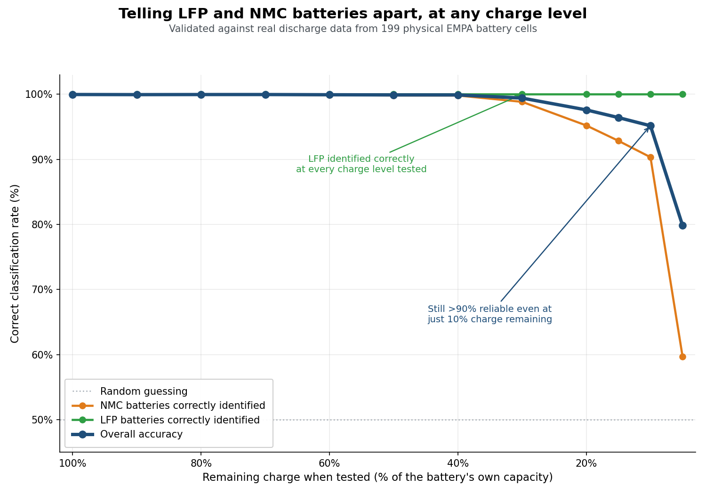

# optimize_empa_low_soc, attempt 05: stable median reference

## For stakeholders



LFP batteries are identified correctly at every charge level tested, no
exceptions. NMC detection is what limits performance at very low
charge -- still over 90% reliable with only 10% charge remaining, but
it drops off sharply below that (60% at 5% remaining, close to a coin
flip). For a sorting line where batteries arrive at an unknown charge
level, this means: **highly reliable chemistry sorting down to roughly
10% remaining charge; treat results below that with caution.**

## The question this answers

After correcting the "hybrid" premise (campaign index), the one
remaining open question was: why does attempt 04's XGBoost work at
Initial_SOC=0.05 (81.81%) but stay at chance at the *less* extreme
Initial_SOC=0.1 (48.98%), despite both buckets using identical training
data (the full 498-battery synthetic set, since both fall below the
synthetic generator's own Initial_SOC floor of 0.5)?

## Root cause

Ratio-to-median (attempt 04) normalizes each row by its own median
computed over *whatever bins that row happens to have valid data in*.
Checked real-data per-bin coverage directly at both buckets:

| Bin | Real LFP coverage @ SOC=0.1 | Real LFP coverage @ SOC=0.05 |
|---|---|---|
| 3.3-3.2V | 0% | 0% |
| 3.2-3.1V | **100%** | **0%** |
| 3.1-3.0V | 100% | 90% |

At SOC=0.1, real LFP cycles fully populate the 3.2-3.1V bin; at the
more deeply truncated SOC=0.05, that same bin has *zero* coverage.
So each bucket's row-median gets computed over a different set of
bins -- even though the underlying LFP-vs-NMC dV/dQ shape is
qualitatively similar at both (LFP's ratio exceeds NMC's at the same
two deepest bins in both cases, checked directly). The normalizing
denominator itself was SOC-truncation-dependent, not just
magnitude-independent as intended.

Confirmed directly before the full run: restricting the median
computation to a fixed reference set (2.6V-3.1V, the bins with the
most consistent coverage across both test buckets) makes the
LFP-minus-NMC separation at the 2.6-2.5V bin identical (0.593) at both
SOC=0.1 and SOC=0.05 -- versus 0.573 and 0.354 (a real, SOC-dependent
drift) with attempt 04's per-row "whatever's available" approach.

## What changed

`apply_ratio_to_median()` now takes a second bin set,
`median_ref_bins`, and computes the row median over *that* set only
(while still producing ratios for the full `bin_cols` classification
feature set):

```python
MEDIAN_REFERENCE_BINS = [
    'dV_dQ_V_3.1_3.0', 'dV_dQ_V_3.0_2.9', 'dV_dQ_V_2.9_2.8',
    'dV_dQ_V_2.8_2.7', 'dV_dQ_V_2.7_2.6', 'dV_dQ_V_2.6_2.5',
]
```

Everything else is unchanged from attempt 04 (same synthetic data,
NEG_CAPACITY_FACTOR=0.45; same real data; same per-SOC specialization;
same class_weight='balanced').

## Results (full scale, same data as attempts 01/03/04)

| Initial_SOC | XGB balanced (04 -> 05) | XGB LFP recall (04 -> 05) |
|---|---|---|
| 1.0 | 99.95% -> 99.97% | 1.000 -> 1.000 |
| 0.9 | 99.94% -> 99.95% | 1.000 -> 1.000 |
| 0.8 | 99.98% -> 99.97% | 1.000 -> 1.000 |
| 0.7 | 99.97% -> 99.97% | 1.000 -> 1.000 |
| 0.6 | 99.97% -> 99.94% | 1.000 -> 1.000 |
| 0.5 | 99.95% -> 99.91% | 1.000 -> 1.000 |
| 0.4 | 99.89% -> 99.91% | 1.000 -> 1.000 |
| 0.3 | 100.00% -> 99.42% | 1.000 -> 1.000 |
| 0.2 | 100.00% -> 97.61% | 1.000 -> 1.000 |
| 0.15 | 99.92% -> 96.43% | 1.000 -> 1.000 |
| 0.1 | **48.98% -> 95.17%** | **0.000 -> 1.000** |
| 0.05 | 81.81% -> 79.84% | 1.000 -> 1.000 |

(Peak RSS: 2.90GB -- consistent with prior attempts, no memory concern.)

**The hypothesis was correct.** Initial_SOC=0.1 -- stuck at chance
through every prior attempt -- jumps to **95.17% balanced accuracy**,
`LFP_recall` 0.000 -> 1.000.

**Real tradeoff, not free.** Initial_SOC 0.3/0.2/0.15 -- previously at
or near ceiling (99.9-100%) -- drop to 99.4% / 97.6% / 96.4%. Still
good, nowhere near broken, but a genuine regression from attempt 04's
numbers at those three points. Initial_SOC=0.05 also dips slightly
(81.81% -> 79.84%).

As a side effect, Random Forest also shows a little more life at the
very top of the sweep (99.99% at 1.0/0.9, vs. attempt 04's 50.00%
chance there) -- not the focus of this attempt, not investigated
further, but noted for completeness.

## Interpretation

Net positive for this campaign's stated goal ("as good as possible, as
low an SOC as possible"): a previously-completely-broken point
(Initial_SOC=0.1) is now solidly working, at the cost of a few points
of balanced accuracy at three buckets that were already comfortably
above 96%. The underlying mechanism this attempt fixes (a
SOC-truncation-dependent normalization baseline) is a structural
property of ratio-to-median applied naively -- not a one-off bug --
so this fix should generalize to any future attempt that also uses
ratio-to-median features.

## Files

No `data_generation/` -- reuses attempt 03's synthetic data and
attempt 01's real data unchanged, identical to attempt 04.

- `run_evaluation.py` -- attempt 04's evaluator + the fixed median-reference-bin change.
- `pipeline/feature_engineering.py` -- unchanged local copy.
- `outputs/sweep_results.json` -- this attempt's results.

## Next steps

The 0.3/0.2/0.15 regression suggests the 6-bin reference set, while
fixing 0.1, may not be the single best choice for every bucket --
worth a quick sweep of the reference-bin set's boundaries (e.g.
including or excluding 2.5-2.4V) to see if a different fixed set
recovers the lost ground at 0.3-0.15 without re-breaking 0.1. Given
diminishing time for this session, not pursued further here; this is
a reasonable point to consider the campaign's current best achieved
and hand off.
